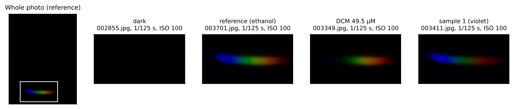
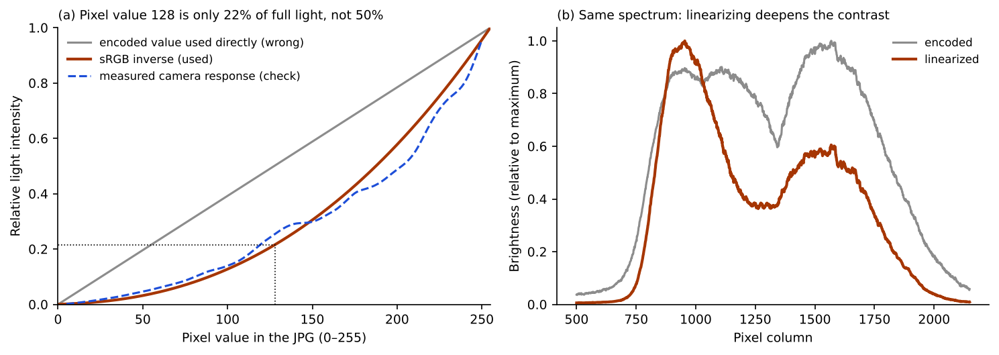
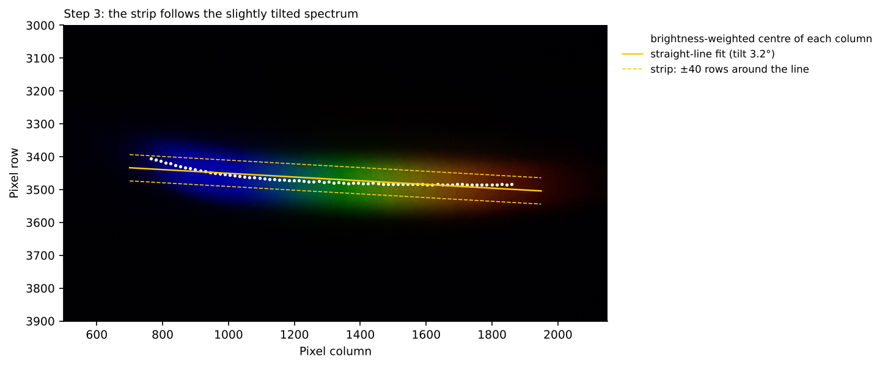
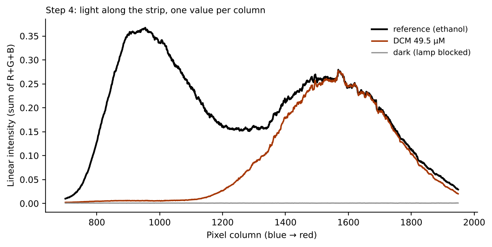
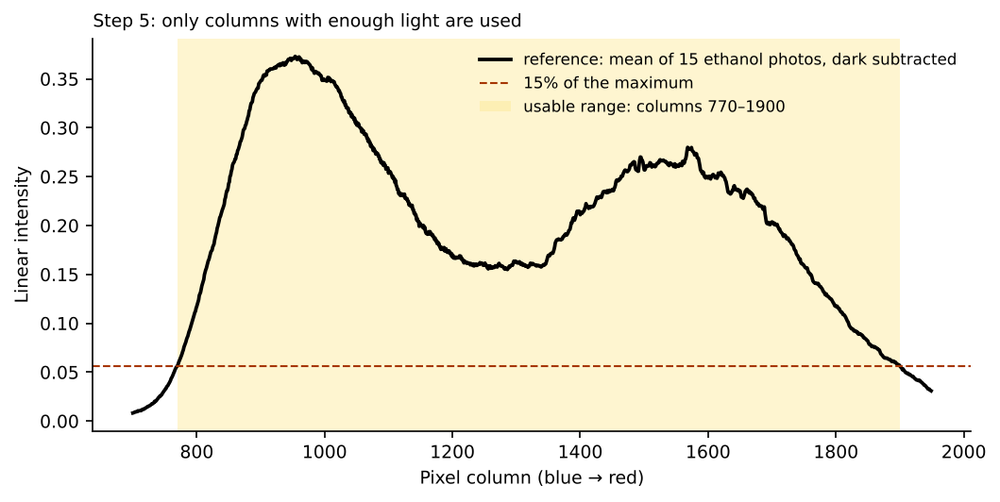
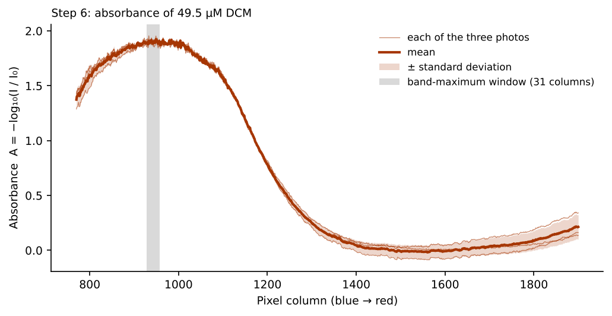
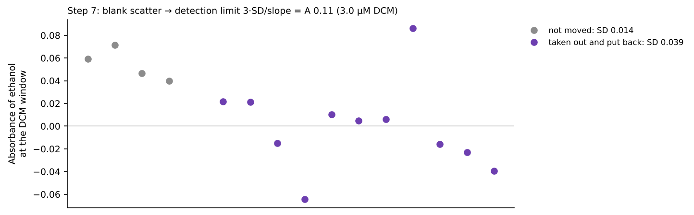
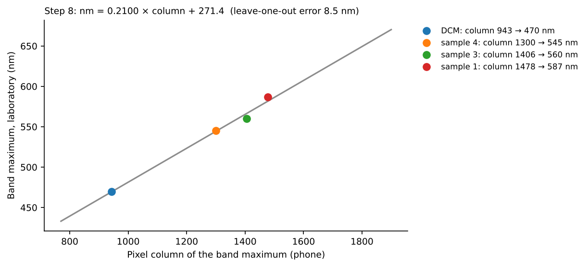
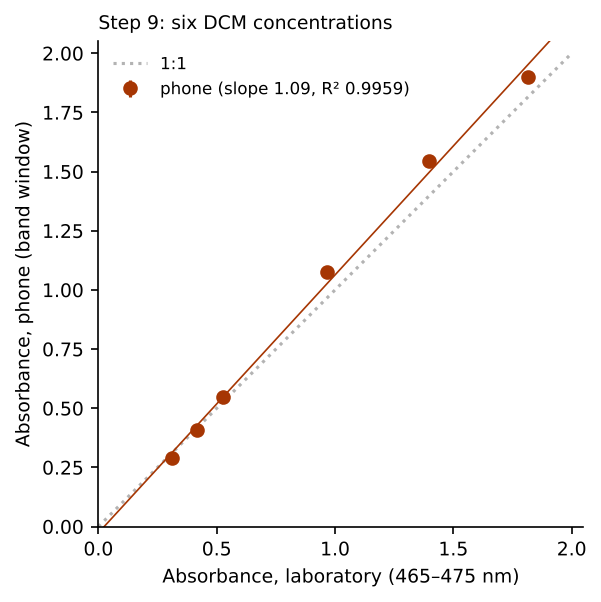
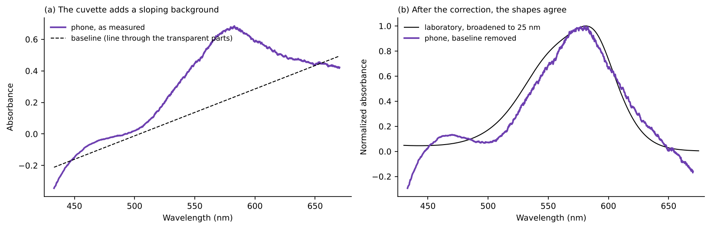

# Python analysis, step by step

This guide walks through what the Python code in `analysis/` does, from a phone photograph to an absorption
spectrum compared with a laboratory spectrophotometer. Every picture below was made from the real photographs
in this repository by `analysis/guide_figures.py`, so you can regenerate them and check that you get the same.

The MATLAB app (`matlab_code/v2_user_friendly/PhoneSpectrometer.m`) does steps 1–6 and 8 with buttons; the
Python code does the same steps and adds the validation (steps 7, 9, 10) used in the paper.

**Contents:** [Install](#0-install-and-run) · [1 Photos](#1-the-photographs) · [2 Linearize](#2-turn-pixel-values-into-light-intensity) ·
[3 Strip](#3-find-the-strip) · [4 Profiles](#4-light-along-the-strip) · [5 Usable range](#5-dark-reference-and-usable-range) ·
[6 Absorbance](#6-absorbance) · [7 Blanks and detection limit](#7-blanks-and-detection-limit) ·
[8 Wavelength axis](#8-wavelength-axis) · [9 Linearity](#9-compare-with-the-laboratory-linearity) ·
[10 Corrections](#10-compare-whole-spectra-corrections) · [Further analyses](#further-analyses) ·
[Outputs](#where-the-numbers-end-up) · [Your own photos](#using-your-own-photos) · [Problems](#troubleshooting)

---

## 0. Install and run

You need Python 3.10 or newer.

```bash
pip install -r requirements.txt
cd analysis
python analyse_paperB.py      # about 1–2 minutes; writes results.json and arrays.npz
python guide_figures.py       # the pictures in this guide (docs/guide/)
```

`analyse_paperB.py` prints a summary as it runs and ends with the shutter and clipping checks. If
`results.json` changes when you rerun it on unchanged data, something in your installation differs; the
version in the repository is the one behind the paper.

---

## 1. The photographs



**What was photographed.** The phone (Samsung Galaxy S25 FE, Pro mode) photographs the spectrum projected on a
screen. Every photo uses the **same settings**: ISO 100, 1/125 s, fixed white balance, manual focus. Four kinds of
photo are needed:

| Photo | Purpose |
|---|---|
| **Dark** (lamp blocked) | camera offset, subtracted from all others |
| **Reference** (ethanol in the cuvette) | light reaching the camera without the sample, *I*₀ |
| **Sample** (e.g. DCM 49.5 µM) | light after the sample, *I* |
| **Repeats** | three photos of each sample, cuvette taken out and put back between them |

**In the code.** The sets are listed by file time stamp near the top of `analyse_paperB.py`
(`DARK`, `ETH_A`, `ETH_B`, `ETH_C`, `DCM`, `ERN`). `photos/photo_sets.md` explains each set.

**Check.** The exposure time and ISO printed in each title must be identical. If one photo differs, its absorbance
is meaningless; the MATLAB app warns about this in its Notes column.

---

## 2. Turn pixel values into light intensity



**Why.** A JPG does not store light intensity. The camera applies a "gamma" curve so the picture looks right to
the eye: a pixel value of 128 corresponds to only about 22% of full light, not 50% (panel a). Absorbance needs
real intensities, so every pixel value is converted back with the inverse sRGB curve:

```python
a = pixel / 255
linear = a / 12.92                          if a <= 0.04045
linear = ((a + 0.055) / 1.055) ** 2.4       otherwise
```

**In the code.** Function `img()` in `analyse_paperB.py`. The option `lin='meas'` uses instead the camera's own
response measured from a series of shutter times (`response.py`, blue dashed line); it gives nearly the same result,
which confirms that the sRGB curve is adequate for this phone.

**What changes (panel b).** The same row of the photograph before and after linearizing: the dips become deeper.
Skipping this step makes absorbances about half as large as they should be (paper, Figure 3a,b).

---

## 3. Find the strip



**What.** The spectrum is a band a few hundred pixels tall, slightly tilted. For every pixel column the code finds
the brightness-weighted centre of the band (white dots), fits a straight line through them (yellow), and uses a
strip of ±40 rows around the line.

**In the code.** The block *"strip following the tilt"* in `analyse_paperB.py`, using the four ethanol references
taken at the end of the series (`ETH_C`). Settings: `COLS = (700, 1950)` (columns searched) and `HALF = 40`
(half-height of the strip in rows). The search is limited to rows 3300–3650, where the spectrum is in these photos.

**Check.** The line should run through the middle of the colors along the whole length. The printed tilt for this
data set is 3.2°. If you move the phone, the strip must be found again.

---

## 4. Light along the strip



**What.** Inside the strip, the linear R + G + B values are averaged over the 80 rows of each column. This gives one
intensity per column, from blue (left) to red (right): the reference (black), the sample (orange), and the dark
photo (grey, almost zero).

**In the code.** Function `profile()` in `analyse_paperB.py`.

**What you can already see.** DCM removes almost all the blue light (columns 800–1100) and passes the red. The
dip in the middle of the reference (around column 1250) is a property of the lamp, not of a sample.

---

## 5. Dark, reference, and usable range



**What.**

1. The averaged dark profile is subtracted from every profile (`dark()`).
2. The reference *I*₀ is the mean of 15 ethanol photos (sets `ETH_B` and `ETH_C`), which averages out small changes
   in how the cuvette sits.
3. Columns where the reference is below **15% of its maximum** are not used (`ok = ref > 0.15 * ref.max()`): there
   is too little light at the ends for a reliable ratio. For this data set the usable range is columns 770–1900,
   which is 433–670 nm after step 8.

---

## 6. Absorbance



**What.** For every column,

> *A* = −log₁₀(*I* / *I*₀)

with *I* and *I*₀ dark-subtracted and linear. Each sample was photographed three times; the thin lines are the three
photos, the thick line their mean, and the band the standard deviation.

**In the code.** The loop `for lin in (True, False, 'meas')` in `analyse_paperB.py` computes absorbances three ways
(linearized, encoded, measured response) so they can be compared. The arrays are saved in `arrays.npz`
(`dcm_lin`, `ern_lin`, …; shape *concentration × repeat × column*).

**The grey window.** For quantitative comparisons the code averages 31 columns around the DCM band maximum
(466–473 nm). The top of the band is flat at about *A* = 1.9 because of stray light; the paper discusses this
(Figure 4, SI section S15).

---

## 7. Blanks and detection limit



**What.** Ethanol was photographed as if it were a sample, 15 times: 4 times without touching the cuvette (grey) and
11 times taking it out and putting it back (violet). Ideally every value is zero. The scatter shows how precise the
instrument is: taking the cuvette out and back is the main source of error (standard deviation 0.039 against 0.014).

**Detection limit.** Three times the standard deviation of the replaced blanks, divided by the slope from step 9:
*A* = 0.11, or 3.0 µM DCM. With the baseline correction of step 10 it improves to *A* = 0.016 (0.45 µM; see
`blank_baseline.py` and SI section S14).

**In the code.** Block *"blanks / repeatability / LOD"* in `analyse_paperB.py`; results in `results.json` under
`blank_lin` and `lod_A`, `lod_uM`.

---

## 8. Wavelength axis



**What.** The pixel columns are converted to wavelengths using samples whose band maxima are known from the
laboratory spectrophotometer: DCM (470 nm) and samples 1, 3 and 4 of the 2026 set. The column of each phone band
maximum (found on a smoothed curve, refined with a parabola) is plotted against the laboratory maximum and fitted
with a straight line:

> nm = 0.2100 × column + 271.4

**Check.** Leaving each point out in turn and predicting it from the others gives an error of 8.5 nm (root mean
square). Samples 2 and 5 are not used: their bands lie at the ends of the usable range, so their maxima cannot be
located.

**In the code.** Block *"wavelength calibration"* in `analyse_paperB.py` (`peak_px()`); `calib_compare.py` tests
alternatives with more points (SI section S13). The MATLAB app does the same with "From known peaks…", or with laser
or fluorescent-lamp photos.

---

## 9. Compare with the laboratory: linearity



**What.** For each of six DCM concentrations, the phone absorbance in the window of step 6 is plotted against the
laboratory absorbance at the same wavelengths. A straight line with slope close to 1 means the phone measures
absorbance correctly. With linearized values the slope is 1.09 and *R*² = 0.996; with encoded values (step 2 skipped)
it is 0.60.

**In the code.** Block *"DCM analytical window"* in `analyse_paperB.py`; results under `dcm_lin`, `dcm_enc`,
`dcm_meas` in `results.json`. The paper's Figure 4 is drawn by `fig5_panels.py`.

---

## 10. Compare whole spectra: corrections



**Why.** Each cuvette transmits slightly differently and never sits in exactly the same place, which adds a smooth
sloping background to the absorbance (panel a). The phone also sees each wavelength smeared over about 25 nm.

**What the code does** (`baselines.py`, used by `fig8_improved.py` for the paper's Figure 5):

1. **Baseline.** Find where the sample is transparent in the laboratory spectrum. If it is transparent on both sides
   of the band, subtract a straight line through those parts (panel a, dashed). If only on one side, fit a
   combination of the 19 measured ethanol blanks instead.
2. **Bandpass.** Broaden the laboratory spectrum to the phone's 25 nm resolution before comparing.
3. **Normalize** both to their maxima for display.

**Check (panel b).** After correction the phone and laboratory bands have the same shape and position. The small
bump near 470 nm and the drop at the blue end are where the reference is dim; the paper reports the agreement as a
correlation coefficient *r* for each sample.

---

## Further analyses

These scripts reproduce the remaining results of the paper and Supporting Information. Each starts with a short
description of what it does.

| Script | What it does | Paper |
|---|---|---|
| `response.py` | Measures the camera's own tone curve from six shutter times (Debevec–Malik) | Figure 3c,d; SI S6 |
| `gamma_2026.py` | Encoded vs linearized absorbance for the 2026 set | Figure 3b |
| `raw_pipeline.py` | Same analysis from the RAW (DNG) files, which are linear without any correction; needs the separate DNG archive | Figure 4b; SI S15 |
| `blank_baseline.py` | Baseline shapes from the 19 ethanol blanks; improved detection limit | SI S14, Figure S12 |
| `calib_compare.py` | Wavelength calibration with more points | SI S13, Figure S11 |
| `fig8_improved.py` | Mixed-dye spectra with all corrections, including stray light for sample 5 and the red-end adjustment for sample 2 | Figure 5; Figures S13, S14 |
| `fig3_merged.py`, `fig5_panels.py`, `fig1_setup.py`, `fig_basic2025.py` | Figures 3, 4, 1 and S10 | |

Run `analyse_paperB.py` first; the others read its `results.json` and `arrays.npz`.

---

## Where the numbers end up

`analysis/results.json` holds every number quoted in the paper. The most useful entries:

| Key | Meaning |
|---|---|
| `tilt_deg`, `usable_px`, `usable_nm` | strip tilt (step 3), usable range (step 5) |
| `cal` | wavelength calibration: `nm_per_px`, `offset`, `loo`, `loo_rms` (step 8) |
| `dcm_lin`, `dcm_enc`, `dcm_meas` | DCM series: mean, SD, fits for linearized, encoded, measured response (steps 6, 9) |
| `uv_beer` | laboratory Beer–Lambert fit of the DCM series (molar absorptivity `eps`) |
| `blank_lin`, `lod_A`, `lod_uM` | blanks and detection limit (step 7) |
| `bands` | phone and laboratory band maxima used for calibration (step 8) |
| `shutter`, `clipping` | exposure checks: clipped fraction of the strip per photo |

`analysis/arrays.npz` (written by `analyse_paperB.py`, not stored in the repository) holds the spectra:
`px` (column numbers), `nm`, `ref_lin`, `ok_lin` (usable columns), `dcm_lin` (6 × 3 × columns), `ern_lin`
(5 × 3 × columns), `blank_lin`, and the `enc` and `meas` versions. Load it with
`np.load('arrays.npz')`.

---

## Using your own photos

1. Take the photos as in step 1 (Pro mode, fixed settings, dark, reference, three repeats per sample, ethanol
   blanks). SI section S12 of the paper is the full protocol.
2. Put them in a folder and point `PH` in `analyse_paperB.py` to it.
3. Replace the time stamps in the lists `DARK`, `ETH_A`, `ETH_B`, `ETH_C`, `DCM`, `ERN` with yours (and the matching
   laboratory files in `DCM_UV`, `ERN_UV`, if you have them).
4. Check the strip search region (`COLS` and the rows `3300:3650`) against one of your reference photos: the
   spectrum must lie inside it. `guide_figures.py` step 3 shows it.
5. Run and look at the step pictures for your data.

For a quick look without any programming, the MATLAB app does steps 1–6 and 8 with buttons
(`matlab_code/v2_user_friendly/HOW_TO_USE.txt`).

---

## Troubleshooting

| Problem | Likely cause |
|---|---|
| `FileNotFoundError` for a photo | wrong `PH` folder, or a time stamp in the lists that is not in your folder |
| Strip line does not follow the colors (step 3) | spectrum outside rows 3300–3650 or columns 700–1950: adjust them |
| Absorbance far below zero or noisy everywhere | reference and sample taken with different settings, or the lamp changed |
| Flat top on a strong band | stray light; dilute the sample so the band maximum is below *A* ≈ 1.5 |
| A band "peak" at the very end of the usable range | the band lies outside the range; the maximum cannot be located (samples 2 and 5) |
| `ModuleNotFoundError: rawpy` | only needed for `raw_pipeline.py`: `pip install rawpy` |
